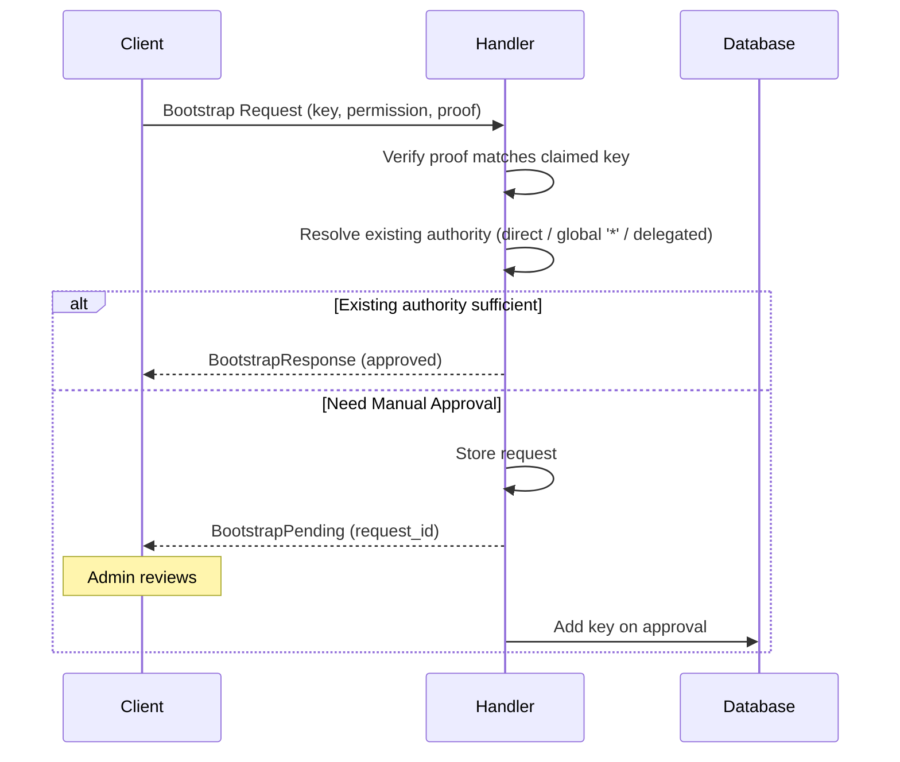

# Bootstrap

Secure key management and access control for new devices joining existing databases.

## Architecture

Bootstrap requests are stored in the sync database (`_sync`), not target databases. A request is auto-approved when the requesting key already holds sufficient authority on the target database; otherwise it enters the manual approval workflow.

## Request Flow



## Existing-Authority Auto-Approval

If the requesting key already has sufficient permission on the target database, approval is immediate without adding a new key. The check resolves authority through the same discovery path the rest of the auth layer uses (`Database::find_sigkeys`), so it recognizes:

- a **direct** key entry for the requesting pubkey,
- a **global `*`** grant, and
- authority reaching the database **only through a delegated database** — the requesting key is a member of a database this one delegates to.

Revoked keys are never treated as sufficient. When no existing authority satisfies the request, it falls through to the manual approval workflow below.

Permission hierarchy uses **lower numbers = higher priority**:

- Global `Write(10)` allows requests for `Read`, `Write(11)`, `Write(15)`
- Global `Write(10)` rejects requests for `Write(5)`, `Admin(*)`

### Delegation discovery is one hop deep

Discovery searches only the databases the target database delegates to **directly**. A key whose authority arrives through a chain — the target delegates to A, A delegates to B, and the key is held in B — is not found, and the request falls through to manual approval.

This is a limitation of _discovery_, not of delegation itself. Entry validation resolves delegation paths of arbitrary length, because a signer names its own path in the signature and the resolver merely walks it, clamping permission bounds at each step. Bootstrap has no such path: the client presents a bare public key, so the server has to search for one, and the search is currently a single level.

Lifting the limit means either making discovery recursive or letting the client supply its delegation path in the request as a search hint. The latter is cheaper, and safe for the same reason the named path is safe during validation — every step is checked against the server's own settings and tips, so a hint can only fail to resolve, never grant.

## Transfer Acceptance

Ticket bootstrap advertises empty tips and is pull-only: it neither reveals the
requester's held frontier nor accepts an incremental response asking for send-back.
Empty tips do not grant access to a held database; the requesting key must still
have local `Read` permission before acquisition proceeds.

The shared response path checks the bootstrap envelope and root against the
requested database (or the incremental response's tree ID). Remote batch ingestion
checks **every supplied Entry's owning tree before the first write**, so a foreign
Entry cannot be filed under its own root through a misleading response envelope.
Storage errors propagate and stop ingestion; previously persisted entries remain
for retry, not rollback.

Success requires every supplied Entry to be locally `Verified`, not merely counted
as stored or present in raw tips. Prefix-closed verification establishes ancestry
for those entries, but cannot detect a branch the peer omitted. A named permission
request also requires the requesting key's **current requested permission** before
the requester publishes the tree/peer relationship. Pending, rejected, and failed
transfers do not publish that relationship; the serving side likewise tracks it
only after a successful authorized response.
Repeated registration of an existing peer address or tree/peer relationship is a
no-op when the stored configuration already matches, rather than another equivalent
Entry in the configuration history.

## Manual Approval API

```rust,ignore
// Query requests
sync.pending_bootstrap_requests()?;
sync.approved_bootstrap_requests()?;

// Approve/reject
sync.approve_bootstrap_request(id, signing_key)?;
sync.reject_bootstrap_request(id, signing_key)?;
```

## Request Status

- **Pending**: Awaiting admin review
- **Approved**: Approval recorded after sufficient target authority is established
- **Rejected**: Request denied; rejection itself adds no grant and does not revoke an independently committed grant

A named-key request must prove possession of the requesting key before the server
looks up, creates, or reports its lifecycle state. Missing, invalid, or mismatched
proof is rejected without creating a request. Anonymous sync remains available for
public databases when no named-key access request is made.

Retries use the request identity `(tree, requesting key, requested permission)`.
A pending retry returns the existing request ID; a rejected retry returns a typed
terminal rejection with that same ID. A different permission is a distinct request.
Approved history does not block a new request after its grant is no longer live.
Proof validation for a pending retry does not consume its nonce; a response that
serves database entries does.

### Split approval and retry reconciliation

Approval writes the target database grant and the `_sync` decision in separate
commits; these are not a cross-database atomic transaction. If the grant succeeds
but the decision write fails, a pending request can already have sufficient access.
A request retry recognizes that live authority, and an approval retry can finalize
the decision without writing an equivalent grant. Repeating an approved decision
acknowledges its history rather than restoring access; repeating a rejected decision
is also a no-op after the Admin check. Rejection remains terminal for the named
request, even if a retry advertises nonempty tips or live authority later changes.

When current authority is insufficient, approval conservatively refuses to replay a
Pending row if signed settings history contains the requesting key (including its
removal), global grants, or delegations, or if the raw frontier differs from the
Verified frontier. An admin must make a fresh explicit settings grant before
finalizing. Global and delegation history can cause refusal even when it did not
grant this particular key. This prevents replay from silently restoring reduced,
revoked, removed, or uncertain authority; it is **not** a general solution for
conflicting authority or delegated-history recovery.

Requests are retained indefinitely for audit trail.

See `crates/lib/src/sync/bootstrap.rs`,
`crates/lib/src/sync/bootstrap_request_manager.rs`, and
`crates/lib/src/sync/handler.rs` for implementation.
