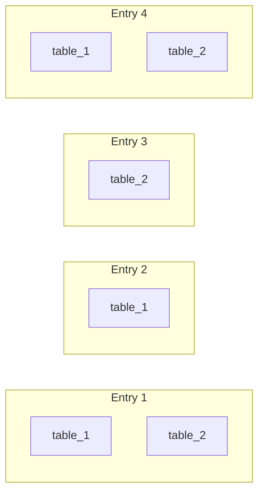
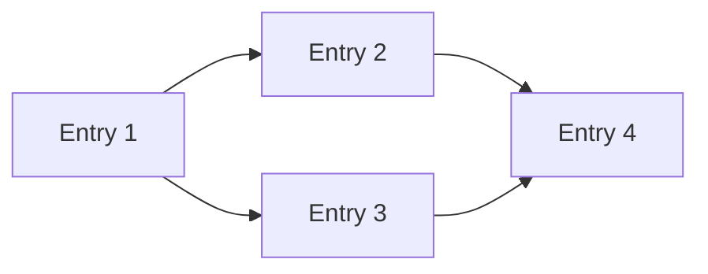
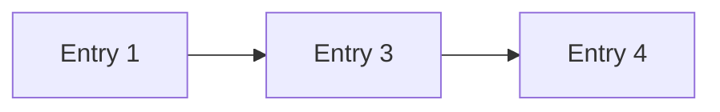

# DAG Structure

Eidetica organizes data in a layered Merkle-DAG called a **Tree**. A Tree consists of Entries that form the main DAG, and each Entry can contain data for multiple subtrees. Each subtree forms its own independent DAG across the Entries.

Each Entry is **immutable** and **content-addressable**. Its ID is a [CID](https://docs.ipfs.tech/concepts/content-addressing/) (Content Identifier) computed by serializing the entry to DAG-CBOR and creating a CID pointing to that deterministic representation. Parent references use these CIDs, forming the Merkle structure.

For simplicity, let's walk through an example Tree with 4 Entries.

## Entries Contain Subtrees

An Entry is the atomic unit. Each Entry can contain data for zero or more named subtrees:



Entry 1 and Entry 4 contain data for both subtrees. Entry 2 only modifies `table_1`. Entry 3 only modifies `table_2`.

## Main Tree DAG

The Tree DAG connects Entries through parent references (hashes of parent Entries). Entry 2 and Entry 3 are created in parallel (both reference Entry 1's hash as their parent). Entry 4 merges the branches by listing both Entry 2 and Entry 3's hashes as parents:



This shows the branching and merging capability of the DAG structure.

## Subtree DAGs

Each subtree forms its own DAG by following subtree-specific parent references.
For ordinary Stores these links express consumption, independently of main
causality. They can skip Entries that did not modify the Store, but may also
leave observed contributions unconsumed. Named parents must still belong to the
same database and Store and be reachable through main ancestry alone.

**table_1 DAG** - Entry 3 is skipped (no table_1 data):


**table_2 DAG** - Entry 2 is skipped (no table_2 data):



The main tree branches and merges, but each subtree DAG remains linear because E2 and E3 modified different subtrees.

## Atomic Cross-Subtree Edits

A Transaction creates a single Entry. This makes it the primitive for synchronized edits across multiple subtrees within a Tree.

In the example above, Entry 1 and Entry 4 modify both `table_1` and `table_2` in a single Entry. Because an Entry is atomic, you always see both edits or neither - there's no state where only one subtree's changes are visible. This enables reliable cross-subtree operations where related data must stay consistent.

## Independent Store Branches

Main causality need not match the Store DAG:

```text
Main:       A(X) -> B(X) -> C(X)
X parents:  A.X: []; B.X: [A.X]; C.X: [A.X]
```

All three Entries can verify. The main frontier is `{C}`, but X's frontier is
`{B.X, C.X}`. Reading X merges both contributions; C's main link to B does not
consume B.X. A later D with X parents `[B.X, C.X]` explicitly joins them and
makes `{D.X}` the Store frontier. Omitting a tip, naming an older or redundant
ancestor, or using empty ordinary Store parents does not invalidate an Entry.

## Whole-Entry Verification, Not Sparse Checkouts

Store DAG independence does not implement sparse verification or Store-only sync.
The current validator requires complete, locally Verified main ancestry and the
historical authority evidence for each whole Entry. In the earlier four-Entry
example, E3 is still needed to verify E4 even when reading only `table_1`.
Missing proof leaves Entries `Unverified`, not partially accepted by Store.
All payloads in a Verified Entry share its status; Store selection is not a
payload-confidentiality boundary.

## Settings Authority

Authentication settings live in `_settings`. Every Entry signs `settings_tips`
identifying its complete causal **pre-write** settings frontier, derived from
its main parents rather than the current live head. A settings write must also
consume that exact frontier. This stricter rule is deliberate: unlike ordinary
Store data, authority context cannot be omitted just because the signer chose
another Store branch. Genesis alone bootstraps its own initial settings.
A signature protects the pin's bytes but does not prove its causal correctness.
See the [verification contract](../design/verification.md) for membership,
height, retry and retained-history adoption rules.
