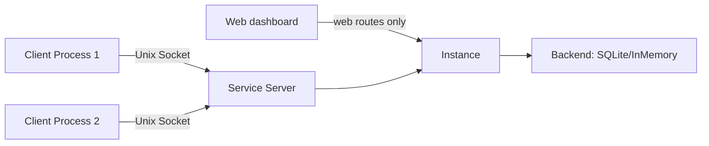
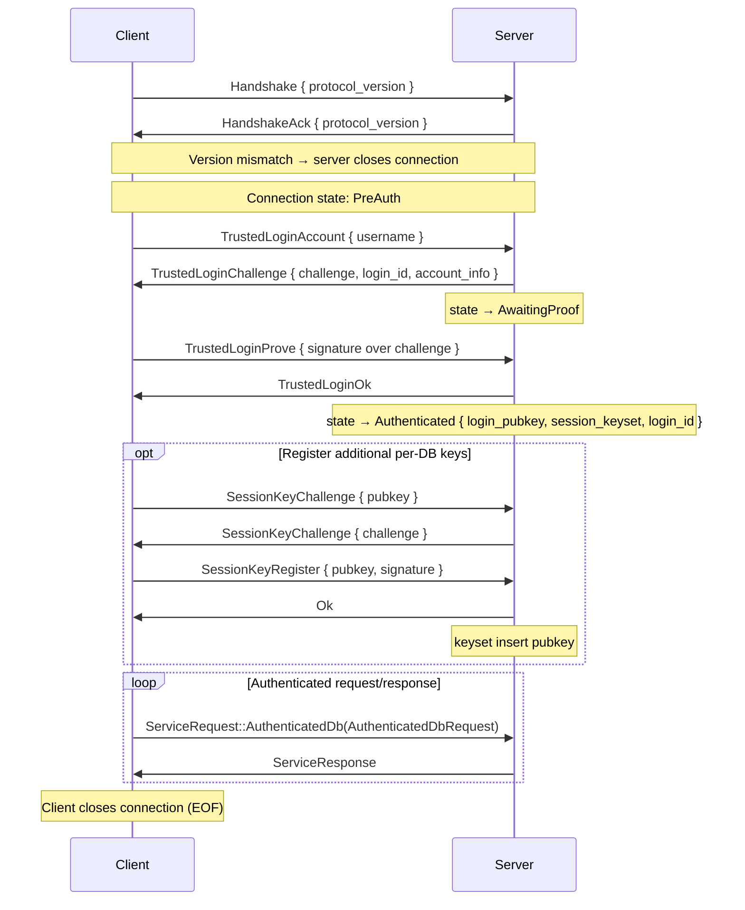

# Service (Daemon) Architecture

The service module (`crate::service`) enables running Eidetica as a local daemon over a Unix domain socket. The RPC boundary sits at the storage-operation level: a `RemoteConnection` forwards every Database-level storage operation to the daemon. Higher-level code (`Database`, stores, `Transaction`, `Instance`) drives I/O through a single `Backend` trait whose remote implementation (`RemoteBackend`) wraps the connection, so the call sites are identical for local and connected instances.

## Architecture Overview



The server wraps a full `Instance` (not just a backend) so it can handle both storage operations and write notifications. A client calls `Instance::connect("unix://...")`, which establishes a `RemoteConnection`, wraps it as a `RemoteBackend`, fetches `InstanceMetadata` over the wire, and constructs an Instance with **no local secrets** (`secrets: None`) — signing keys are derived client-side after login, never held by the constructed Instance until a user logs in.

### Module Structure

| Module              | Role                                                                                              |
| ------------------- | ------------------------------------------------------------------------------------------------- |
| `service::protocol` | Wire types: `Handshake`, `ServiceRequest`, `ServiceResponse`, `DatabaseOp`, frame I/O             |
| `service::error`    | `ServiceError` wire format and error reconstruction                                               |
| `service::server`   | `ServiceServer` — accepts connections, runs the auth state machine, gates and dispatches requests |
| `service::client`   | `RemoteConnection` — the `RemoteBackend` transport + `trusted_login`                              |

Historical Store state is served through the shared Store-state record substrate rather than a service-layer cache module; every request is bound to the authenticated session (see [Store state](#store-state)).

### Snapshot-bound State

`StateReader::capture` authorizes Read from the engine's retained Verified frontier and returns a `ReadContext` with the database, root Snapshot and read scope. It does not run verification, enumerate Stores or prepare signing data. Reading authority can require Settings I/O. A local transaction can start at that Snapshot with `Database::new_transaction_at`; its staged Store, index and settings changes remain local to the transaction and cannot grant signing authority.

`StateReader::read_doc` checks that the requested root cut belongs to the database's retained Verified history. The proven signer needs database Read at that cut **or** at the serving engine's latest Verified frontier. The historical check folds Settings at the requested cut and follows any delegations at their committed pointers, not at tips supplied by the caller. Neither a Snapshot value nor a previous successful read is an access grant.

For example, a member can read a pre-membership Snapshot on Monday using their current Read grant. Once the member leaves and loses that grant, they can still read a Snapshot that records their membership, but not the pre-membership Snapshot. Revocation removes the current grant via that key; it does not override a grant at a requested historical cut. The engine does not search for intervening grants.

The engine folds only the requested supported plaintext Doc projection, looking up the named Store's type at the same cut when needed. It does not use client-uploaded projections, decrypt Stores, or substitute latest. Diagnostic cuts cannot produce this projection. A `ComputedDoc` carries its source context, not a claim of independent verification by its recipient. A transport must also bind the producer's identity before its consumer can make a trust decision. Raw signed Entry exchange is separate.

`ServiceServer::without_credentials` disables hosted-login and native login-record commands for this socket; it does not disable signer possession proof or change the socket's trust model. `ServiceServer::with_state_admission` lets the engine decline a computation separately from Read authorization and login configuration. A typed `Refused` is neither denial nor successful empty state. An eligible signer needs no daemon login record.

The legacy `GetStoreState` JSON operation still requires current Read. It computes the projection at one captured Verified cut but omits context from the response. `BeginTransaction` remains a legacy write-preparation bundle. Neither defines a new State wire protocol.

## Wire Protocol

The protocol uses **length-prefixed JSON frames** over a Unix domain socket.

### Frame Format

```text
┌──────────────────┬──────────────────────┐
│ Length (4 bytes) │ JSON payload         │
│ big-endian u32   │ (up to 64 MiB)       │
└──────────────────┴──────────────────────┘
```

Each frame is a 4-byte big-endian length prefix followed by a JSON-serialized payload. Maximum frame size is 64 MiB (`MAX_FRAME_SIZE`); frames exceeding this are rejected on both read and write. `write_frame`/`read_frame` handle serialization and framing; `read_frame` returns `None` on clean EOF (before any length-prefix byte) and an `UnexpectedEof` I/O error when the stream ends mid-prefix or mid-payload.

The unstable service protocol is v0.1: handshakes and acknowledgments require `protocol_version: 0` and `protocol_revision: 1`.
Both values must match before any operation is sent.
Legacy v0 peers without a revision and peers with another revision are rejected; upgrade clients and daemon together.
There is no capability negotiation, downgrade, or legacy watch fallback.
The peer-to-peer sync protocol is unchanged.

Updated service peers tolerate additions at four named extension points:

- An unknown top-level request operation or nested `DatabaseOp` receives `{"Response":"Unsupported"}`. The server performs no operation and does not change login or session-key state. A database envelope must still have a valid `root_id` and `identity`.
- An explicit `Unsupported` or unknown variant inside `Response` consumes exactly one FIFO response slot. That caller receives an I/O error with kind `Unsupported`; later responses retain their association, including after an abandoned response wait. There is no retry or execution fallback.
- An unknown optional variant inside `Notification` is ignored without consuming a response slot or invoking callbacks. Known notifications retain their behavior.

These are externally tagged JSON enums: a unit variant is a string; a payload variant is a single-key object. Known payloads still use their original strict serde decoders. Malformed JSON or known payloads, unknown required nested types (including auth identities and read scopes), unknown or ambiguous outer server envelopes, and oversize/truncated frames retire the connection. No authority is inferred from an unknown operation. The existing length prefix and 64 MiB cap are unchanged.

These extension points apply only after the v0.1 handshake.
They do not make required payload changes backward compatible.
In particular, Snapshot-only watches replace bracket notifications, and `GetSnapshot { scope }` replaces `GetVerifiedTips`.
`#[non_exhaustive]` protects Rust source compatibility, not the wire.

### Connection Lifecycle



1. **Handshake**: client sends `Handshake { protocol_version }`; server validates and acks. On mismatch the server acks with its own version and closes the connection.
2. **Authentication**: trusted login (see Security Model below) retrieves a credential record and proves the root key.
   Alternatively, `SignerChallenge { pubkey }` returns only a fresh challenge; `TrustedLoginProve` completes proof of a caller-held signer without a login record.
   `GetInstanceMetadata` is also permitted before authentication.
   Both authentication paths enter the same public-key session state; neither bypasses per-tree Auth.
3. **Optional session-key registration**: once authenticated, the client may prove possession of additional pubkeys via `SessionKeyChallenge`/`SessionKeyRegister`. Each successfully proven pubkey joins the connection's `session_keyset` and can then act as the identity on subsequent ops. See [Session Keyset](#session-keyset) below.
4. **Authenticated request loop**: every storage operation travels inside `ServiceRequest::AuthenticatedDb`. The server handles requests in connection order. `RemoteConnection` serializes frame writes, not response waits; its background reader associates responses with pending callers in FIFO order and dispatches notifications separately.
5. **Termination**: client closes its write half (EOF); the server detects EOF and cleans up.

### Observe host sync registration

On an authenticated Unix connection, `RemoteConnection::observe_host_sync` sends an `AuthenticatedDb` request with the exact database `root_id`, the acting `identity`, and `op: "ObserveHostSync"`. The session key must have an explicit, active Admin grant on `_users`. The acting identity must be proven on that connection and have current Read on the requested root. Neither a matching database name nor Admin on the target alone is sufficient.

`HostSyncObservation` echoes `root_id` and reports `daemon_id` (the serving device's public key) and `observed_at_ms` (the daemon's Unix time at the start of the read). It reports two separate facts from one accepted sync snapshot:

- `registration` is `Registered` with the combined enable, sync-on-commit, and interval settings; `Unregistered` means there is no registration for the root; `Unknown` means it could not be determined.
- `mapped_peers` contains the public keys mapped to that root. `[]` means no mapped peers; `null` means the mapping could not be determined. A registered root can have no peers.

If the daemon has no sync engine or newer persisted sync entries are still unverified, both facts are unknown. An incomplete registration or peer record makes the affected fact unknown without discarding the other one. No peer addresses, account preferences or application properties are returned. This is a read of persisted host state, not an atomic read with the caller's preferences or evidence of a connection or replication.

### Explicit connection retirement

`RemoteConnection::retire(&self)` exposes the same connection-local teardown used
on transport failure and last-handle Drop. It first fences requests, then uses
an owned duplicate Unix socket descriptor to synchronously shut down **both**
directions, drains pending response slots, closes notification dispatch lanes,
and aborts the reader task. It never acquires the async writer mutex or sends an
RPC. A blocked frame write wakes with a native I/O error; queued calls fail the
closed check before writing. Retained clones cannot keep the failed transport
usable. Repeated retirement is harmless, including after peer EOF.

This is not a protocol operation, rollback, callback/task join, or server-side
cancellation guarantee. Started writes can have committed without an observed
acknowledgement, and responses already delivered can still succeed. The caller
keeps ownership of started operations through their native results and reconciles
uncertain outcomes; there is no automatic replay. A fresh `Instance::connect`
(or `RemoteConnection::connect`) constructs a separate connection that must be
authenticated again. Old Instances, Databases and clones are not rebound.

### Cancellation and frame integrity

The pending response slot is enqueued under the writer lock before sending the
frame, preserving request/response order even if a response arrives immediately.
Cancellation or failure during the frame write retires the **whole connection**:
the client drops its write half, marks the connection dead, and clears pending
waiters. A subsequent request cannot append bytes to an incomplete JSON frame.
Callers must reconnect rather than reuse that stream.

Once the frame is completely written, dropping only the response wait leaves its
FIFO slot in place. The reader consumes that response even when its caller is gone,
so the next response cannot be delivered to the wrong request. Other requests can
continue using the connection. Neither case rolls back already-dispatched server
work or proves that a remote operation did not commit; retry must reconcile
persisted state rather than assume cancellation undid it.

## Security Model

Client-side signing over the Unix service socket. All socket logins store and serve authenticated encrypted bundles, including empty-password logins, without sending passwords or decrypted signing keys to the daemon. Empty-string wrapping provides no meaningful confidentiality against a bundle holder, including the daemon: client-side unlock is a process boundary, not secrecy for a known password. When the optional dashboard is enabled, web logins decrypt signing keys in the daemon process for their in-memory sessions; the socket protocol remains client-side signing.

- **AccountSession keys stay client-side**: `TrustedLoginAccount` returns the user's full record (`account_info`, including the encrypted `AccountCredentials`) in the same round-trip as the challenge. The client derives the wrapping key locally (Argon2id over the password), unlocks the authenticated Account locator/key bundle, signs the challenge, and reads only that login's current encrypted bundle and metadata from native local state to build its `AccountSession` — no credential read of `_users`. The signing key never crosses the socket.
- **Authentication via challenge-response**: the daemon issues fresh random challenge bytes per login attempt. Successful decryption of the user's signing key on the client _is_ password verification; the daemon verifies the returned signature against the user's stored public key. No password is sent over the wire.
- **`TrustedLogin` naming is load-bearing**: the flow assumes the caller is already trusted by the socket's filesystem permissions. Over a network transport this would need a PAKE instead — the name flags that gap deliberately.
- **Encrypted stores remain opaque to the daemon**: per-database encrypted CRDTs merge as `Vec<EncryptedBlob>`; the daemon participates in storage and sync without ever holding a content encryption key.
- **Filesystem permissions**: missing directories in the socket path are created with mode `0700`, including under a permissive process umask. The socket is mode `0660`.

Caller-owned signers can use [`AccountSigner`](account_credentials.md#service-execution) without a daemon-held login bundle.
A proof-only connection carries a generated cache scope, not a registered local-login identity.
The optional dashboard remains an explicit daemon-side signing exception.

The socket directory is the local trust boundary.
An existing parent must be owned by the daemon user, not writable by group or others, and reached without symlinked path components.
Its group, setgid bit, and traversal permissions can intentionally grant another Unix user access; every process that can connect receives the existing fully trusted service API.
Unsafe shared-writable and symlinked layouts are rejected rather than supported.
An adjacent advisory lock coordinates cooperating daemon owners, stale sockets are recovered, and graceful or dropped servers remove only the socket identity they bound.

See the `crate::service` module rustdoc for the full design rationale, including why daemon-side signing (the earlier draft) was rejected.

## Request / Response Types

### ServiceRequest

The top-level request enum is intentionally flat, keeping the pre-auth surface visible at a glance:

| Variant                                                   | When                                                                                                        |
| --------------------------------------------------------- | ----------------------------------------------------------------------------------------------------------- |
| `TrustedLoginAccount { username }`                        | Pre-auth step 1 — request a login challenge                                                                 |
| `TrustedLoginProve { signature }`                         | Pre-auth step 2 — return the signed login challenge                                                         |
| `SignerChallenge { pubkey }`                              | Pre-auth — prove a caller-held signer without fetching login credentials; complete with `TrustedLoginProve` |
| `GetInstanceMetadata`                                     | Pre-auth — fetch server identity (used by `Instance::connect`)                                              |
| `SessionKeyChallenge { pubkey }`                          | Post-auth — request a challenge bound to `pubkey` so the client can prove possession                        |
| `SessionKeyRegister { pubkey, signature }`                | Post-auth — return the signed challenge; on success `pubkey` joins the connection's session keyset          |
| `TicketBootstrapPrepare { ticket }`                       | Post-auth — select a ticket route; see [Ticket Bootstrap](#ticket-bootstrap)                                |
| `TicketBootstrap(Box<TicketBootstrapRequest>)`            | Post-auth — send a client-signed bootstrap request through the daemon's sync engine                         |
| `RegisterLocalAccount { login_id, account_info }`         | Post-auth — native login registration, gated by instance-admin on `_users` Auth                             |
| `ListLocalAccounts`                                       | Post-auth — instance-admin-gated login names, no credentials                                                |
| `LocalAccountState { login_id }`                          | Post-auth — read only the exact authenticated login's native record                                         |
| `ExchangeLocalAccountState { login_id, expected, value }` | Post-auth — observed-byte replacement in that same login scope                                              |
| `AuthenticatedDb(Box<AuthenticatedDbRequest>)`            | A `DatabaseOp` — the envelope for tree-scoped storage operations                                            |

`AuthenticatedDbRequest` carries an identity claim that the server validates against the connection's session keyset before dispatch:

```rust,ignore
pub struct AuthenticatedDbRequest {
    pub root_id: ID,      // database whose auth_settings gate this op
    pub identity: SigKey, // claim; hint pubkey must be in session_keyset
    pub op: DatabaseOp,   // tree-scoped by construction
}
```

### DatabaseOp — the wire surface

Every storage operation rides a single `DatabaseOp` enum carried in `AuthenticatedDbRequest`. The server runs its own `Database` on its local `Instance`, so verification-on-read, the Verified frontier, and CRDT-state materialization happen server-side by construction. Each variant is tree-scoped through the containing request's `root_id`.

| Variant                                         | Purpose                                                                                                                                                                          |
| ----------------------------------------------- | -------------------------------------------------------------------------------------------------------------------------------------------------------------------------------- |
| `BeginTransaction { stores, scope }`            | Acquire parent tips, settings tips, and merged settings needed to build+sign a transaction locally for `stores`, parents drawn from `scope`'s snapshot. Read.                    |
| `SubmitSignedEntry { entry }`                   | Submit a finished, client-signed entry. Server stores it `Unverified` and runs its own verification pass. **Verification-gated, not session-gated** (see below).                 |
| `GetSnapshot { scope }`                         | Database's selected-frontier tips. Read.                                                                                                                                         |
| `GetStoreState { store }`                       | Server-materialized merged state of an **unencrypted** store, against the server's Verified frontier. Returns a `WireCrdtValue`. Read.                                           |
| `GetStoreEntries { store, tips, scope }`        | Ordered (by subtree height), verified, opaque store entries reachable from `tips` in `scope` — the universal primitive, including encrypted stores. Read.                        |
| `GetStoreTipsUpToEntries { store, .. }`         | Store tips reachable from given main-tree entry IDs. Read.                                                                                                                       |
| `TryVerifiedStoreSnapshot { store }`            | Indexed tips of one named Store, with Read on an existing database. Returns `Ok` without IDs when the index cannot answer; never reconstructs Store tips from history.           |
| `ComputeMergeState { store, .. }`               | Lowest common ancestor + path to tip entries in a store DAG, fused into one RPC. Read.                                                                                           |
| `GetEntry { id }`                               | Fetch a single entry by id (gating tree resolved server-side post-fetch). Read.                                                                                                  |
| `VerifyEntrySignature { id }`                   | Re-run native historical authentication for one Entry; target and delegated-proof Read gates apply.                                                                              |
| `CreateTicket`                                  | Build a point-in-time database locator after the request is gated for Read on the target database.                                                                               |
| Store-state resolve / staging / record get/scan | Read permission. Resolve and lazily read published records; only build or publish private Derived state, subject to admission.                                                   |
| `SetInstanceMetadata { metadata }`              | Rewrite daemon-level pointers to its own system DBs. Special-cased server-side to gate `Admin` on `_databases` (a daemon-global system tree) instead of the request's `root_id`. |

`VerifyEntrySignature` runs the existing historical validator on the daemon, preserving pinned settings, inherited floors, permission bounds and incomplete-evidence errors.
The Entry must belong to the requested database; the session-keyset-validated acting identity needs current Read on that database and every claimed delegated tree.
The 10-step/64-tip bounds are checked before delegated Read queries.
The verdict does not set verification status, acquire missing evidence or fall back to privileged reads; access gates may still perform their normal opportunistic verification.
Legacy v0 peers must upgrade before using these operations.

Operations deliberately **not** exposed over the wire — `update_verification_status`, `get_instance_secrets`, `all_roots`, and raw verification-status/enumeration queries — live on the concrete local `BackendImpl` engine (reached via `Backend::local_engine`), so a `RemoteBackend` simply does not provide them.

`update_verification_status` is off-wire **by design, not just for tidiness**: verification is a local trust decision. If a client could set it over the socket, a client (or anything that reached the socket) could assert "this entry is `Verified`" without the server having validated it — exactly the caller-asserted-status hole the storage API was hardened to close. So the daemon's Instance owns verification: it stores everything `Unverified` and runs `Database::verify()` itself. The frontier/`allow_unverified` distinction is applied by the daemon-side `Database`, and each handle explicitly selects its read scope without changing the daemon's verification decisions.

`DatabaseOp::required_permission()` reports roles: Write for `SubmitSignedEntry` (advisory; the server verifies the signed Entry instead), Admin for `SetInstanceMetadata` (gated against `_databases` instead of `root_id`), and Read for every other variant (advisory for `UnsubscribeWrites`, which checks subscription ownership instead). The tree gate checks capability classes, not permission priority. The match is exhaustive, so a new operation cannot inherit Read by falling through.

Published views and private builds use opaque random tokens stored only in the connection context. Every use rechecks the authenticated user, the database, and the connection. Disconnect, explicit abort, and bounded idle expiry delete unpublished private builds. The unchanged 64 MiB frame cap is enforced per request and response, so multi-record state is paged or chunked and a single record that cannot fit is refused with `RecordTooLarge`.

### ServiceResponse

| Variant                                                       | Payload                                                             |
| ------------------------------------------------------------- | ------------------------------------------------------------------- |
| `Entry(Entry)` / `Entries(Vec<Entry>)`                        | One or many entries                                                 |
| `EntrySignatureValid(bool)`                                   | Historical signature verdict, not verification status               |
| `Ids(Vec<ID>)`                                                | One or many IDs                                                     |
| `Ok`                                                          | Success with no data                                                |
| `Unsupported`                                                 | Unknown operation; no action performed                              |
| `Token(String)`                                               | Opaque server-issued staging capability                             |
| `Record` / `RecordPage` / `RecordView`                        | Lazy point, bounded page, and published-record-set responses        |
| `TransactionContext(TransactionContext)`                      | Parent tips + settings, response to `DatabaseOp::BeginTransaction`  |
| `CrdtValue(WireCrdtValue)`                                    | Materialized merged state, response to `DatabaseOp::GetStoreState`  |
| `MergeState(MergeState)`                                      | LCA + path, response to `DatabaseOp::ComputeMergeState`             |
| `DatabaseTicket(DatabaseTicket)`                              | Point-in-time locator, response to `DatabaseOp::CreateTicket`       |
| `InstanceMetadata(Option<InstanceMetadata>)`                  | Optional instance metadata                                          |
| `TrustedLoginChallenge { challenge, login_id, account_info }` | Challenge bytes + the user's full record (login)                    |
| `TrustedLoginOk`                                              | Login succeeded; connection now authenticated                       |
| `SessionKeyChallenge { challenge }`                           | Challenge bytes the client signs to register an additional key      |
| `TicketBootstrapRoute { address, peer, tips }`                | Selected route, answering peer, and empty tips                      |
| `TicketBootstrapOutcome(TicketBootstrapOutcome)`              | `Complete`, `Pending { .. }`, or `Rejected { .. }`                  |
| `LocalAccounts(Vec<String>)`                                  | Installation-local login names                                      |
| `LocalAccountState(Option<Vec<u8>>)`                          | Exact native account-state bytes, scoped to the authenticated login |
| `LocalAccountStateExchanged(bool)`                            | Whether observed-byte replacement succeeded                         |
| `Error(ServiceError)`                                         | Error response                                                      |

## Ticket Bootstrap

`AccountSession::join` on a connected instance joins a database from a ticket without a client-side sync engine and without sending the account's private key to the daemon.
A bootstrap request proof (`SyncRequestAuth`) is bound to the answering peer and the requester's advertised tips, so the exchange takes two requests:

1. The client registers the requesting key in the session keyset, then sends `TicketBootstrapPrepare { ticket }`.
   The daemon races the ticket's address hints with its own transports and returns the chosen `address`, the `peer` that answered, and empty `tips`; Prepare does not read or disclose local database state.
2. The client signs a proof over `peer`, the database, and `tips` with the requesting key, and sends it with the requested permission, key name, and optional approver metadata in `TicketBootstrap`.
   The daemon requires the proof's key to be in the session keyset and the proof to cover that exact empty-tip request, then sends it through its own sync engine.
   The response must be confined to the requested database and every supplied Entry must verify; current requested permission is checked before publishing the tree/peer relationship.
   Incremental send-back is refused on this path.
   It re-handshakes the route before recording it, so the address must answer as `peer`; and if the daemon already holds the database, the proof's key must already be able to read it there, because the peer store is shared by every user of the daemon.

Pending and rejected results travel as `TicketBootstrapOutcome` data rather than as `ServiceError`s, so the client rebuilds `SyncError::BootstrapPending` and `SyncError::BootstrapRejected` exactly.
Neither outcome creates Account state or a new serving relationship; existing legacy Account rows are preserved.
Only after a successful exchange does the client discover the valid SigKey and record mapping and preferences atomically in its native local record, publishing cache from acknowledged or read-back persisted state.
An identical retry does not append equivalent configuration history, and preferences changed during the network wait are not overwritten.
Success returns an opened `Database` only after those client-side writes finish.
Pending requires an explicit `join` retry after approval; rejection is terminal for the request.
Requests on a connection are handled in order, so the join occupies its connection until the peer answers.
A dropped future or disconnected caller may leave peer-side effects, replicated data or a persisted local account record without its acknowledgement.
Already-dispatched daemon work may continue after client EOF, but daemon/process death can interrupt it.
Reconnect and retry explicitly; there is no cancellation API or automatic restart-safe completion.
The shared [frame cancellation rules](#cancellation-and-frame-integrity) apply: an interrupted frame retires the connection, while cancelling only its response wait retains FIFO response association.
Held/unreadable acquisition and native conflicting-authority/delegated-history recovery remain incomplete; see [current recovery limits](../user_guide/bootstrap.md#current-recovery-limits).

Continuing replication is the daemon's, and its sync requests are signed with the daemon's device key.
A database that grants only the joining user key, with no global grant, therefore needs separate device-key authorization for later pulls.
`join` does not enroll a device or promise ongoing private background authority.
The wildcard-authorized replication test covers global access, not private device enrollment.

## Session Keyset

A connection's cryptographic identity is **a set of pubkeys, not a single pubkey**. The set is seeded at login with the pubkey that proved `TrustedLoginProve` (the user's _root_ pubkey, called `login_pubkey`) and grows as the client proves possession of additional keys via the registration handshake.

```rust,ignore
// In service::server
enum ConnectionState {
    PreAuth,
    AwaitingProof { challenge: Vec<u8>, expected_pubkey: PublicKey, .. },
    Authenticated {
        login_pubkey: PublicKey,
        session_keyset: HashSet<PublicKey>,           // includes login_pubkey
        pending_key_challenges: HashMap<PublicKey, Vec<u8>>,
        login_id: String,
        ..
    },
}
```

No `ConnectionState` variant holds a `PrivateKey` (enforced by a structural test).

### Why a keyset, not a single pubkey?

An `AccountSession` has many pubkeys — a root key, a device key, per-DB keys created via `AccountSession::add_private_key`, etc. Writes signed by a per-DB key produce entries whose tree auth grants that key, not the login key. With a single-pubkey session, reads of those trees would be denied (the login key isn't a member of the tree the per-DB key authored). The keyset model lets the same connection drive ops on every tree the user actually has a key for, without forcing one connection per key.

### Registration handshake

Adding a pubkey to the keyset is a two-step PoP:

1. Client → server: `SessionKeyChallenge { pubkey }`. Server generates a single-use, pubkey-bound random challenge, stores it in `pending_key_challenges[pubkey]`, returns it.
2. Client signs the challenge with `pubkey`'s private key, sends `SessionKeyRegister { pubkey, signature }`. Server verifies, removes the challenge (consumed on success or failure), inserts `pubkey` into `session_keyset` on verify, returns `Ok`.

Each `RemoteConnection` caches successful registrations in a `Mutex<HashSet<PublicKey>>` so `register_session_key(signing_key)` is idempotent — a repeat call for the same key short-circuits without touching the wire. The login pubkey is pre-cached on `trusted_login` success.

The handle constructors that need per-DB identities register on the caller's behalf, so most client code never touches the registration API directly:

- `Database::create(instance, signing_key, settings)` registers `signing_key` before constructing the returned `RemoteBackend`-backed handle.
- `Database::open_remote(.., identity)` is paired by `Instance::open_system_db_for_session(root, signing_key)`, which registers `signing_key` before opening.
- `AccountSession::open_database_with_key(root, key_id)` registers the user-held signing key for `key_id` before routing through `Database::open_remote` on a connected instance.

## Access Control: the three gates

Authenticated requests pass three gates before dispatch:

1. **Gate 1 — connection state**: the connection must be `Authenticated`. The identity hint, if any, must have its `pubkey` field present in the connection's `session_keyset` (proof of possession registered earlier). The resolved value becomes the **acting pubkey** for this op; an absent hint defaults to `login_pubkey`. The cross-check rejects identity claims for keys the client never proved — an attacker that hijacks an authenticated session still can't act as a key whose private material isn't on the client. **Submit (`DatabaseOp::SubmitSignedEntry`) is exempt** from this check: an admin transporting a user-signed entry legitimately carries a non-keyset identity, and the verification gate downstream is the real boundary (see [Verification-gated submit](#verification-gated-submit)).
2. **Gate 2 — per-tree permission**: the server loads `auth_settings` for the request's `root_id`, resolves the **acting** pubkey's permission, and rejects the op unless it covers `required_permission()`. Resolution tries direct membership first; on miss it falls back to the wildcard (`*`) slot, so a tree's global grant actually applies to any keyset member that isn't otherwise listed. `GetEntry` is gated _post-fetch_ (`gate_entry_read`): the fetched entry's owning tree is resolved and `Read` is required before content is returned, in case the entry's owning tree differs from the request's `root_id`.
3. **Gate 3 — cross-tree admin**: `SetInstanceMetadata` rewrites daemon-global pointers, so its gate ignores the request's `root_id` and is applied against `_databases.auth_settings` requiring `Admin`. The dispatcher special-cases this variant; it fails closed if `_databases` is unreadable (D8).

Authorization for entry-id-keyed writes is being hardened separately (tracked as D1); see V1 Limitations.

### Verification-gated submit

`SubmitSignedEntry` is **verification-gated, not session-gated**. The submit handler stores the incoming entry `Unverified` and runs the server's own verification pass against the tree's _pinned_ auth lineage. An attacker without a key the tree's auth grants cannot produce a `Verified` entry, and unverified junk is excluded from every default read by the frontier cut — so the per-tree session gate would add no correctness or isolation property here, and would only block legitimate transporters (e.g. an admin session carrying a user-signed genesis).

The core rule for the wire surface: **reads are session-gated (confidentiality boundary); submits are verification-gated (integrity boundary)**.

## Error Handling Across the Wire

Errors serialize as `ServiceError { module, kind, message }`.

**Server side**: `dispatch` catches any `crate::Error`, extracting the error's module name, discriminant name, and display message.

**Client side**: `service_error_to_eidetica_error()` reconstructs the appropriate `crate::Error` from the `(module, kind)` pair:

| Module     | Kind                         | Reconstructed Error                                                                                                                             |
| ---------- | ---------------------------- | ----------------------------------------------------------------------------------------------------------------------------------------------- |
| `backend`  | `EntryNotFound`              | `BackendError::EntryNotFound`                                                                                                                   |
| `backend`  | `VerificationStatusNotFound` | `BackendError::VerificationStatusNotFound`                                                                                                      |
| `backend`  | `EntryNotInTree`             | `BackendError::EntryNotInTree`                                                                                                                  |
| `backend`  | `NoCommonAncestor`           | `BackendError::NoCommonAncestor` (emitted only by older peers — current engines report disjoint histories as a `None` merge base, not an error) |
| `backend`  | `EmptyEntryList`             | `BackendError::EmptyEntryList`                                                                                                                  |
| `instance` | `DatabaseNotFound`           | `InstanceError::DatabaseNotFound`                                                                                                               |
| `instance` | `EntryNotFound`              | `InstanceError::EntryNotFound`                                                                                                                  |
| `instance` | `InstanceAlreadyExists`      | `InstanceError::InstanceAlreadyExists`                                                                                                          |
| `instance` | `DeviceKeyNotFound`          | `InstanceError::DeviceKeyNotFound`                                                                                                              |
| `instance` | `AuthenticationRequired`     | `InstanceError::AuthenticationRequired`                                                                                                         |
| (other)    | (other)                      | `Error::Io` with the original message                                                                                                           |

Unrecognized combinations fall back to an `Io` error carrying the original message, so callers use the same error-handling patterns (e.g. `err.is_not_found()`) regardless of local vs. remote. A compile-time exhaustive match over `crate::Error` forces a wire-mapping decision whenever a new variant is added, and a round-trip test asserts every mapped pair survives without hitting the fallback.

## Write Coordination

`Database::on_write` watches the registering handle's visibility: the Verified prefix by default, or the retained non-Failed frontier for `.allow_unverified()`.
It delivers an initial Snapshot atomically ordered with registration and tree mutations, then only selected-frontier changes.
The payload has no previous frontier, source, entry bodies, acknowledgment or missed-event count.
The caller owns its last-successfully-processed checkpoint.
A rejected opt-in tip can restore its surviving parents; this is a new selected Snapshot, not a removal event or a rewrite of historical materialization.

Under the tree lock, `Instance::publish_write` reads each required retained frontier once and offers it to the corresponding registrations.
Each mailbox retains a pinned initial Snapshot, a single latest-wins pending update, and a last-selected marker for suppression.
A worker invokes and awaits the user closure outside tree locks, sequentially per registration.
Neither local nor connected commits wait for application callbacks.
Slow registrations do not block other registrations, even on the same tree.
Errors and panics are logged; there is no automatic replay on failure.

The daemon alone publishes connected watches.
Each `SubscribeWrites { subscription_id, scope }` has its own connection-local ID and binds the original tree, acting identity and `ReadScope`.
It owns a normal daemon-side watch whose worker sends `Notification::DatabaseWrite { root_id, subscription_id, snapshot }` in registration order.
Different subscribers may coalesce different intermediate frontiers; there is no identical-every-transition promise across clients.
The socket reader routes each Snapshot directly to its exact local mailbox, never invoking or awaiting user code.
Responses retain their separate FIFO request association.
No duplicate local fire follows a connected client's commit.

Read permission and session-key possession are checked at subscription time.
Notifications contain no entry bodies; a revoked subscriber can still learn a frontier, but every explicit content read is gated against current authorization.
Sync uses a separate internal write hook and its own Verified-only checkpoints, not application deliveries or opt-in views.

Dropping a callback cancels its local pending and in-flight work immediately.
The client sweep sends cancellation for that ID after the grace period; IDs are not reused by a replacement registration, so a delayed unsubscribe cannot cancel its successor.
Cancellation matches the original tree and proven identity within the authenticated connection, even if that identity no longer has Read permission.
Client teardown (explicit retirement or last user-facing transport handle drop)
shuts down the socket and aborts the reader without waiting for retained write
owners. Retirement cancels attached watches, and disconnect drops all daemon-side
handles.
The shared daemon writer queue is still unbounded: core mailbox bounds do not claim transport backpressure or a fixed global memory cap for unlimited subscriptions.
See [Write Callbacks](../user_guide/transactions.md#write-callbacks) for caller usage.

## Store state

Historical current state is materialized into derived record sets in the shared Store-state record substrate (see [Store state](store_state.md)). The daemon owns those records; clients resolve views and read points or bounded pages through them, so a `Table` read fetches the rows it asks for rather than a whole materialized `Doc`.

Cached state is scoped by [`CacheScope`](crate::backend::CacheScope):

- `CacheScope::Shared` — daemon-computed state (visible to every authorized user; the bytes were produced by the trusted server-side merge).
- `CacheScope::Login(uuid)` — client-computed state (visible only within the submitting login's scope).

Every client-supplied `StoreStateRequest` is rebound to the session before it reaches the backend: its database must be the one the request was gated against, a shared-scope request is narrowed to the session user, and a request naming another user's scope is refused. Resolution then falls back from the user scope to the shared one, so a daemon materialization is reused instead of rebuilt per user, while a client can never publish into shared cached state or another user's cached state.

Begin, Stage, Publish, and Abort each recheck live Read on an existing database.
Storage enforces [private cache admission](cache.md#retention-and-verification-boundaries)
independently of the reader's role. If the storage engine cannot provide those
bounds, the service declines uploads rather than permitting unbounded staging.
Client materializations supply neither daemon authorization nor Entry verification.

## Database-Level Wire API

The server runs its own `Database` on a local `Instance`, so verification-on-read, the Verified frontier, and CRDT-state materialization happen server-side by construction. Every op is intrinsically tree-scoped through the containing `AuthenticatedDbRequest`.

### Unified `Backend` seam

`Transaction`, `Store`, `Database`, and `Instance` all drive I/O through a single `Backend` trait (`crate::instance::backend::Backend`) with no local-vs-remote branching at the call sites:

| Method                                            | Purpose                                                                       |
| ------------------------------------------------- | ----------------------------------------------------------------------------- |
| `get(id)`                                         | Fetch a single entry                                                          |
| `snapshot(tree)` / `store_snapshot(tree, store)`  | Raw DAG tips (Verified-frontier filtering stays in `Database`)                |
| `store_snapshot_at(tree, store, up_to)`           | Store tips reachable from given main-tree entries                             |
| `store_at(tree, store, snapshot)`                 | Every store entry reachable from `snapshot`                                   |
| `compute_merge_state(tree, store, ids)`           | LCA + path within a store, resolved together against one view                 |
| `resolve_store_state` / record get / record scan  | Cached-state reads (see [Store state](#store-state))                          |
| `put(entry)`                                      | Persist an entry                                                              |
| `write_entry(verification, entry, source)`        | Persist a signed entry, applying verification and dispatching local callbacks |
| `get_instance_metadata` / `set_instance_metadata` | Daemon-global system-DB pointers                                              |

The trait is the _intersection_ of what both implementations can honor with the same meaning. Off-seam local-only operations (instance secrets, verification-status mutation, raw `all_roots`/`get_tree` listings) are deliberately **not** on the trait and live on the concrete in-process engine. They are reached only where one exists, via `Backend::local_engine() -> Option<Arc<dyn BackendImpl>>` (returns `None` on a remote backend).

Two implementations exist:

- **`LocalBackend`** — wraps an `Arc<dyn BackendImpl>` (the concrete in-process storage engine). `local_engine()` returns it.
- **`RemoteBackend`** — wraps a `RemoteConnection` and translates each method to a wire RPC. Carries only an optional acting identity (`None` = the connection's session identity); tree-scoped methods take the tree from the caller, and `get` derives its gating tree server-side from the fetched entry, so no per-handle root is bound and one connection multiplexes every per-database identity via the session keyset. `local_engine()` returns `None`.

`Database` selects the implementation at construction time:

```rust,ignore
// Local: share the Instance's backend.
ops: instance.backend().clone(),

// Remote (service): a per-handle RemoteBackend bound to the calling identity.
ops: Arc::new(RemoteBackend::new(conn, Some(identity))),
```

### Encrypted-store split

Encrypted stores (wrapped in `PasswordStore`) are opaque to the daemon — the daemon stores and syncs `EncryptedBlob` entries without ever holding a content encryption key. The `DatabaseOp` surface handles the encryption boundary with two complementary primitives:

- **`GetStoreState { store }`** — the **unencrypted fast path** (Doc/Table stores). The server loads the store's entries, CRDT-merges them locally, materializes the merged state, and returns a `WireCrdtValue` (`serde_json::Value`). No decryption; the server works with plaintext because the underlying data is unencrypted.

- **`GetStoreEntries { store, tips, scope }`** — the **universal primitive** for encrypted stores. Returns opaque `Entry` objects reachable from `tips`, ordered by subtree height, already verified against the server's Verified frontier. The client receives encrypted entries it can decrypt and CRDT-merge locally. This works identically for encrypted and unencrypted stores — the server never touches content.

- **Store-state resolve/stage/publish and record reads** provide a merge fast-path that avoids re-folding entries whose merged state is already materialized. For encrypted Stores, the client decrypts and materializes state, then publishes user-scoped ciphertext. A warm encrypted Table point read uses point-record gets for PasswordStore metadata and the requested row without scanning the row generation or reconstructing history. The daemon cannot validate the plaintext semantics of a client-built encrypted cache. See [Store state](#store-state) and [Encryption](encryption.md).

The encrypted-store-over-service tests cover both paths: `test_database_encrypted_store_roundtrip` checks opaque Entry retrieval, while `test_warm_encrypted_table_service_point_read_is_lazy` proves a warm Table point read stays on record gets and does not reconstruct Store history. Decryption, local merge, and encrypted row-envelope verification are client-only.

### Read scope

`ReadScope` controls the DAG snapshot exposed over the wire:

- **`Verified`** (default) — only the maximal all-`Verified` ancestor-closed prefix of the DAG (the "Verified frontier"). Tips that are still `Unverified` are replaced by their nearest `Verified` ancestors; `Failed` entries are always dropped.
- **`AllowUnverified`** — select the retained non-Failed frontier, not a recursively sanitized accepted prefix. The caller must explicitly opt in via `Database::allow_unverified()`.

Store tips are derived separately from the selected main cut using explicit
Store-parent edges. `GetStoreTipsUpToEntries`, `BeginTransaction`, and materialized
Store reads must retain unconsumed tips even when their Entries are main
ancestors of another Store tip. For example, main A(X)->B(X)->C(X) with B.X and
C.X both parenting A.X yields Store tips `{B.X, C.X}`; an explicit Store join may
replace both. Submitted ordinary Store writes need not consume all observed
tips, while `_settings` parents and signed pins must match the exact causal
pre-write settings frontier. The daemon validates whole Entries, including named
Store-parent membership and effective heights, not independent contributions.

`BeginTransaction` carries the caller's `ReadScope`: selected parents come from the same snapshot as its reads. Selection is not permission to commit against unsettled ancestry: signed local commit validation requires Verified parents, and server-side verification defers a submitted Entry with Unverified parents. `GetSnapshot { scope }` and subscriptions carry the same scope as the handle's reads. The [verification contract](../design/verification.md#writes-inherit-the-selected-boundary-not-weaker-validation) defines the distinction.

### Gate scope for `AuthenticatedDb`

Every `DatabaseOp` variant carries `root_id`. Gate 2 checks Read for queries and private Derived staging, with the instance metadata exception described above. Signed writes use the Entry's own verification and write authorization, not the connection's cache permissions.

`SubmitSignedEntry` is the exception — verification-gated, not session-gated, as covered in [Access Control](#access-control-the-three-gates) above.

### One envelope, one op enum

The current wire is the result of a series of consolidations:

- An earlier draft mirrored every storage-trait method onto its own `BackendOp` variant, carried in a separate `ServiceRequest::Authenticated(AuthenticatedRequest)` envelope. That surface placed auth/verification/merge above the wire boundary, treating the daemon as a passive key-value store.
- The Database-level `DatabaseOp` / `AuthenticatedDb` path was added alongside it so the daemon could own verification-on-read, the Verified frontier, and CRDT-state materialization.
- The collapse landed `SetInstanceMetadata` into `DatabaseOp` (dispatcher-special-cased to gate against `_databases`), folded `Get` into `DatabaseOp::GetEntry`, and removed the parallel `BackendOp` enum, `ServiceRequest::Authenticated`, and `AuthenticatedRequest` outright.
- The earlier `NotifyEntryWritten` RPC was removed: the server's `SubmitSignedEntry` handler fires its own write callbacks in-process.

The shape today is a single envelope (`AuthenticatedDb(Box<AuthenticatedDbRequest>)`) carrying a single op enum (`DatabaseOp`) over every storage operation.

## Feature Gate

```rust,ignore
#[cfg(all(unix, feature = "service"))]
pub mod service;
```

The `service` feature is in the default `full` set; the `unix` gate restricts it to platforms with Unix domain sockets.

## Testing

Two complementary layers:

- **`tests/it/service.rs`** — dedicated integration tests for the service layer: handshake, the TrustedLogin challenge-response, the three gates (unauthenticated rejection, per-tree allow/deny, cross-tree denial), per-user cache isolation, concurrent clients, and the user lifecycle.
- **`TEST_BACKEND=service`** — runs the full integration suite through the socket, exercising the RPC layer, serialization, and error reconstruction:

```bash
TEST_BACKEND=service cargo nextest run --workspace --all-features
just test service
nix build .#test.service
```

The full suite passes 1:1 against the service backend. Tests that exercise _process-local_ subsystems — `Sync::new` (needs the local device key), `backend.all_roots` / `backend.get_verification_status` (raw-backend listings that have no wire equivalent), low-level delegation resolution that needs local verification evidence, the CRDT merge cache, and multi-`AccountSession`-on-one-`Instance` patterns that would all wedge against a single wire-mode session pubkey — go through always-local helpers regardless of `TEST_BACKEND`:

- `test_local_instance()` — like `test_instance()` but always builds an in-memory local `Instance`.
- `test_local_instance_with_user(username)` and `test_local_instance_with_user_and_key(username, key_name)` — counterparts to the wire-aware versions.
- `setup_tree_with_user_key_local()` and `TestContext::with_local_database()` — for tests that poke at local-only backend state.

`service::historical_signatures` uses a shared fixture for local/socket parity, concrete-key attribution, invalid/incomplete proof, inherited floors and revocation.
Its non-admin, Read-only client checks bound acting identity and current Read on every delegation hop, including already-open handles.

The architectural seam — wire-path tests vs. subsystem tests — is explicit at the helper level. The test harness bootstraps the server-side Instance with a passwordless `admin` user via `Instance::create_backend(..., NewAccount::passwordless("admin"))`, then logs in over the wire as that user. (The old `admin`/`admin` auto-bootstrap is gone; production deployments now run `eidetica daemon init --username <NAME>` with explicit credentials, and the test harness mirrors that shape.)

## V1 Limitations

This is a **fully trusted local-client** v1. Filesystem access to the socket grants the whole service API; the following are deferred with tracked follow-ups:

- **Lock-poisoning posture**: the per-connection session `RwLock` and the `RemoteBackend` per-connection cache mutex are poison-tolerant (handlers recover the guard from a poisoned lock rather than panicking), but other `std::sync::Mutex` sites in the service path still use `lock().unwrap()`. Documented at the lock sites; the remaining ones must be audited before serving multiple or untrusted clients.
- **Verification status is never asserted over the wire**: the service protocol carries no way for a client to assert a verification status; entries arriving over the wire are stored `Unverified` and earn `Verified` only via the daemon's own validation pass. The status model, the pinned-settings validation that makes it staleness-free, the disclosure posture, and the unbuilt authority-_reduction_ (revocation) gap are documented in the [Verification Model](../design/verification.md) design doc.
- **`snapshot()` on a connected Database delegates to `self.ops()`**: handles built via `Database::create` or `Database::open_remote` carry a `RemoteBackend` bound to a per-DB identity; reads use that identity (not the connection's login pubkey). Handles built via plain `Database::open` on a connected instance share the `Instance`'s `RemoteBackend` (which uses the connection's default session identity) — appropriate for code that wants the connection's login pubkey to drive reads. The previous heuristic remote-detection in `Database::snapshot` was replaced with an explicit ops delegation.
- **No sync delegation**: `enable_sync()` on a remote Instance is a silent no-op (sync runs daemon-side; the client can't enable it from over the wire). A future admin-gated `EnableSync` RPC would let a client ask the daemon to enable its sync subsystem, parallel to the native registration RPC used by `InstanceAdmin::create_account`.

## Future Work

- **PAKE for network transport**: `TrustedLogin` is safe only because the socket is filesystem-gated. A network transport must replace it with a password-authenticated key exchange.
- **Sync delegation**: as above.
- **Notification backpressure**: the per-connection writer channel is `mpsc::unbounded_channel`; a stalled client reader buffers notifications in memory. The transport follow-up must coalesce latest-wins per subscription while preserving initial delivery and non-droppable responses.
- **Derived-key caching**: cache the Argon2id-derived encryption key in an OS secret store with a TTL, evolving the daemon into an ssh-agent-like key agent to eliminate repeated password prompts for CLI tools.
