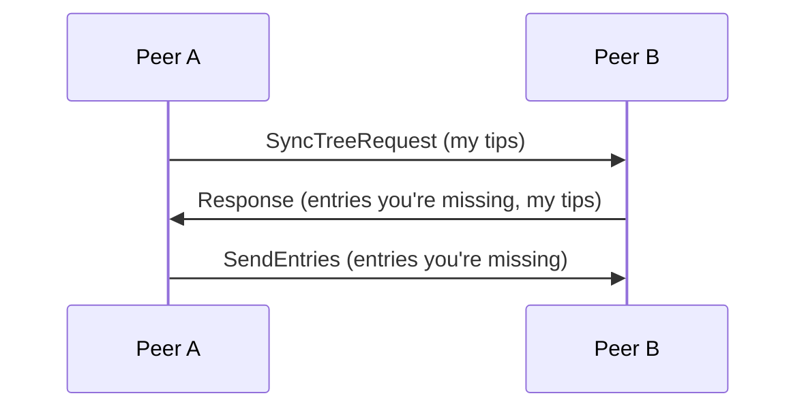
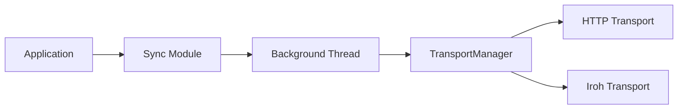

# Sync

Eidetica uses a Merkle-CRDT based sync protocol. Peers exchange tips (current DAG heads) and send only the entries the other is missing.

## Sync Flow

1. Peer A sends its current tips for a Tree
2. Peer B compares DAGs, returns entries A is missing plus B's tips
3. A sends entries B is missing based on the tip comparison

This is **stateless** and **self-correcting** - no tracking of previously synced entries.

These tips describe raw DAG possession, not Verified membership. New received
Entries are stored Unverified; neither peer authentication nor transfer completion
asserts local acceptance. Default Database reads use the retained Verified frontier,
which can lag raw tips until local validation succeeds. Write-event cursors also
remain raw boundaries. See the canonical [verification contract](../design/verification.md)
for promotion, partial-history reads and retry limits.

## Bootstrap vs Incremental

The same protocol handles both cases:

- **Empty tips** (new database): Peer sends complete Tree from root
- **Has tips** (existing database): Peer sends only missing entries

## Transport Options

- **HTTP**: REST API for server-based sync
- **Iroh P2P**: QUIC-based with NAT traversal for peer-to-peer sync

Both transports implement the same `SyncTransport` trait. Multiple transports can be enabled simultaneously.

## Architecture

The Sync module queues operations for a background thread, which uses a `TransportManager` to route requests to the appropriate transport based on address type. Failed sends are retried with exponential backoff.

### Multi-Transport Support

The `TransportManager` enables simultaneous use of multiple transports:

- **Address-based routing**: Each transport declares which addresses it can handle via `can_handle_address()`
- **First-match routing**: Requests are routed to the first transport that can handle the address
- **Independent servers**: Each transport runs its own server on different ports/protocols
- **Unified API**: `accept_connections()` starts all registered transports, `get_all_server_addresses_async()` returns all addresses

## Current Limitations

The sync system is currently simple and 1:1. Each peer connection requires manual setup with explicit peer addresses. Planned improvements include:

- Peer discovery
- Address sharing and relay coordination
- Multi-peer sync orchestration

See [Bootstrap System](bootstrap.md) for the key exchange flow when joining a database.

## Shared forward history vocabulary

Native [history deltas](service.md#forward-store-snapshot-deltas-v2) define a
Store-scoped fixed target, known ancestor closure, canonical forward prefix,
target-local covered Snapshot and explicit completion. P2P Database pages use
main parents/heights, not one Store's parents. They freeze the source target and
stop at exact advertised known IDs, preserving the peer selection contract
rather than treating arbitrary peer tips as a strict forward Store delta.
`their_tips` advertises the whole server frontier, not a prefix acknowledgement.

## Bounded peer frames (v1)

HTTP `/api/v1` and Iroh `eidetica/v1` share a length-prefixed compact-JSON codec.
Each complete envelope, including its four-byte network-order length, fits the
unchanged 1 MiB peer cap. Bootstrap and incremental pull producers request native
Database pages with complete wrapper overhead reserved before fetching bodies.
A single Entry that cannot fit is refused explicitly; it is never omitted,
truncated, split or admitted as an oversized singleton.

One original authenticated request covers Start, ordered Pages and End within
one exchange. The request nonce is consumed once; current Read/sync-enabled
policy is rechecked before subsequent pages. Metadata/cursors bind the frozen
scope and target but grant no authority. Receivers check scope, order, exact
continuations, parent closure, delivered counts and terminal coverage, and wait
for End **and clean EOF** before returning any entries to normal ingestion.
Errors, trailing operations, truncation and cancellation discard the collector.
Entries still require the existing local signature/causal-auth verification;
framing and `Ack`/`Count` are not Verified proofs.

Input-list uploads use one descriptor and exclusive offsets per Database in
sorted Database order, retaining input order and idempotent duplicates within
that Database. An incomplete submission is not ingested. Both transports keep a
30-second absolute exchange deadline; successful reads/pages do not extend it.
HTTP retains its connect/read-stall bounds. Dropping a body or the caller's
response receiver cancels production. Inbound operations and outbound collectors
have separate eight-operation admission ceilings, with native per-page permits
released before network backpressure. Legacy `/api/v0` and `eidetica/v0` only
return bounded unsupported-protocol errors; no legacy history fallback occurs.
This is a wire version change, not a mixed-fleet deployment procedure.

Remaining limits: logical response consumers and incoming upload collectors
still retain O(total entries) vectors. Input-list framing retains references and
one page; HTTP additionally uses one bounded 1 MiB upload bridge. Reverse
`collect_ancestors_to_send` and queued/retry body producers still materialize
vectors before framing, and the existing ID queue has no byte cap. Those source
allocations are not made bounded merely by the wire codec. Sparse-replica
reconciliation and public consumer streaming are not implemented here.
