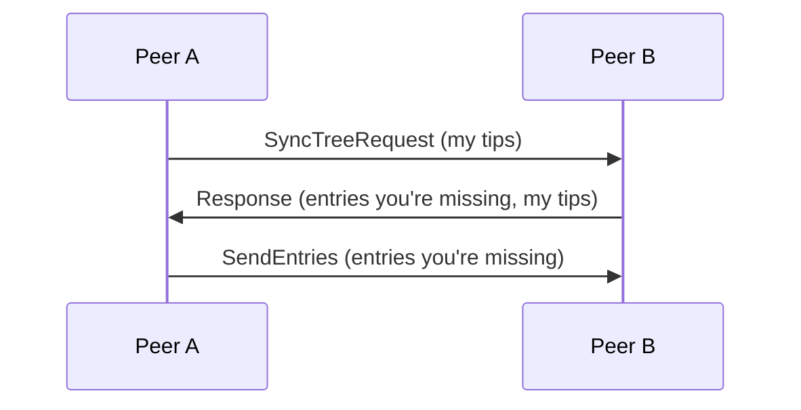
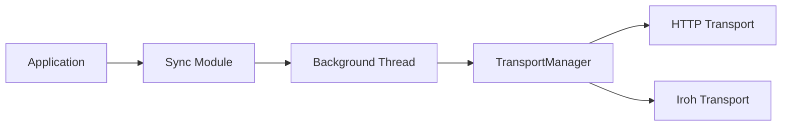

# Sync

Eidetica uses a Merkle-CRDT based sync protocol. Peers exchange tips (current DAG heads) and send only the entries the other is missing.

## Sync Flow

1. Peer A sends its current tips for a Tree
2. Peer B compares DAGs, returns entries A is missing plus B's tips
3. A sends entries B is missing based on the tip comparison

This is **stateless** and **self-correcting** - no tracking of previously synced entries.

These tips describe raw DAG possession, not Verified membership. New received
Entries are stored Unverified; neither peer authentication nor transfer completion
asserts local acceptance. Default Database reads use the retained Verified frontier,
which can lag raw tips until local validation succeeds. Write-event cursors also
remain raw boundaries. See the canonical [verification contract](../design/verification.md)
for promotion, partial-history reads and retry limits.

## Bootstrap vs Incremental

The same protocol handles both cases:

- **Empty tips** (new database): Peer sends complete Tree from root
- **Has tips** (existing database): Peer sends only missing entries

## Transport Options

- **HTTP**: REST API for server-based sync
- **Iroh P2P**: QUIC-based with NAT traversal for peer-to-peer sync

Both transports implement the same `SyncTransport` trait. Multiple transports can be enabled simultaneously.

## Architecture

The Sync module queues operations for a background thread, which uses a `TransportManager` to route requests to the appropriate transport based on address type. Failed sends are retried with exponential backoff.

### Multi-Transport Support

The `TransportManager` enables simultaneous use of multiple transports:

- **Address-based routing**: Each transport declares which addresses it can handle via `can_handle_address()`
- **First-match routing**: Requests are routed to the first transport that can handle the address
- **Independent servers**: Each transport runs its own server on different ports/protocols
- **Unified API**: `accept_connections()` starts all registered transports, `get_all_server_addresses_async()` returns all addresses

## Current Limitations

The sync system is currently simple and 1:1. Each peer connection requires manual setup with explicit peer addresses. Planned improvements include:

- Peer discovery
- Address sharing and relay coordination
- Multi-peer sync orchestration

See [Bootstrap System](bootstrap.md) for the key exchange flow when joining a database.

## Named blob protocol

Blob bytes do not travel in the Entry sync JSON protocol.
HTTP uses `POST /api/v0/blob` with `BlobRangeRequest { cid, start, end }` and an octet-stream Bao response.
A 404 with `x-eidetica-blob: 0` means absent; an unmarked 404 is an unsupported blob endpoint, not evidence about local possession.
Other errors remain errors.
`POST /api/v0/blob/has` accepts `BlobAvailabilityRequest { cids }` and returns `BlobAvailabilityResponse { available }` in request order.
A batch contains at most 64 explicit raw-codec BLAKE3 CIDv1 addresses, never prefixes or an inventory query.
Clients reject an answer with a different number of results and bound its body to 64 KiB.

Iroh uses a separate `eidetica/blob/v0` ALPN, leaving `eidetica/v0` Entry sync unchanged.
Each bidirectional stream carries one JSON `BlobWireRequest` (Availability or Range), capped at 64 KiB, followed by FIN.
Responses start with one status byte: 0 absent, 1 success with payload, 2 invalid request, or 3 server failure.
Successful availability payloads use the same JSON response as HTTP; successful ranges carry the same Bao encoding.
Unknown status values, missing status and malformed payloads fail the read.
A peer on an older version without the blob endpoint or ALPN reports an error, not absence through a fallback JSON fetch operation.

A range payload starts with an eight-byte little-endian logical blob size, followed by the Bao proof and chunk-aligned bytes.
The receiver validates the CID envelope, the 64 MiB logical-size cap and the proof before returning the requested window.
Each transport bounds received bytes to the capped requested length plus 1 MiB of Bao alignment/proof overhead.
HTTP reuses its shared connect/read-timeout client; Iroh bounds connection establishment and the request exchange.
The handler serves only local bytes under the existing blob read/GC lock and cannot induce a fetch or retention request.

Explicit `Sync` commands select the transport by the supplied address.
Database reads select active peers from the existing Database/peer relation, not the Instance peer inventory, and try bounded address fallback.
At most four outbound blob commands execute concurrently; admission refuses excess work rather than waiting inside the engine loop or accumulating background tasks.
They run separately from Database synchronization and create no retry service or automatic publication path.
