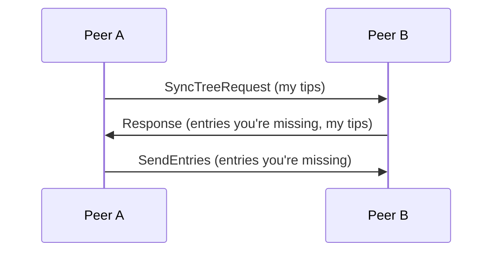
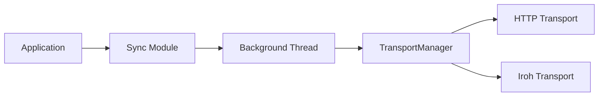

# Sync

Eidetica uses a Merkle-CRDT based sync protocol. Peers exchange tips (current DAG heads) and send only the entries the other is missing.

## Sync Flow

1. Peer A sends its current tips for a Tree
2. Peer B compares DAGs, returns entries A is missing plus B's tips
3. A sends entries B is missing based on the tip comparison

This is **stateless** and **self-correcting** - no tracking of previously synced entries.

Sync advertises the local retained Verified frontier and serves only its Verified
ancestry. Unverified and Failed entries are not outgoing payloads, even when an
application opts into an unverified read view. Received Entries are still stored
Unverified: a sender's acceptance is not evidence of the receiver's acceptance.
The receiver runs its own validation. See the [verification contract](../design/verification.md).

The internal write hook owns a checkpoint per peer and database, independently
of application notifications. The first queueing includes the Verified ancestry;
later queueing walks from the current Verified frontier to the last queued one.
An unchanged frontier queues nothing. These checkpoints mean queued, not
acknowledged, and are volatile like the queue. Periodic DAG comparison recovers
restart gaps without relying on an application's last processed Snapshot.

Explicit sends and queued/retried batches recheck local verification before
submitting entry payloads to the transport. A non-Verified or unheld entry refuses
the whole batch rather than reporting a successful partial send. Existing
permission and revocation checks still apply.

## Bootstrap vs Incremental

The same protocol handles both cases:

- **Empty tips** (new database): Peer sends complete Tree from root
- **Has tips** (existing database): Peer sends only missing entries

## Transport Options

- **HTTP**: REST API for server-based sync
- **Iroh P2P**: QUIC-based with NAT traversal for peer-to-peer sync

Both transports implement the same `SyncTransport` trait. Multiple transports can be enabled simultaneously.

## Architecture

The Sync module queues operations for a background thread, which uses a `TransportManager` to route requests to the appropriate transport based on address type. Failed sends are retried with exponential backoff.

### Multi-Transport Support

The `TransportManager` enables simultaneous use of multiple transports:

- **Address-based routing**: Each transport declares which addresses it can handle via `can_handle_address()`
- **First-match routing**: Requests are routed to the first transport that can handle the address
- **Independent servers**: Each transport runs its own server on different ports/protocols
- **Unified API**: `accept_connections()` starts all registered transports, `get_all_server_addresses_async()` returns all addresses

## Current Limitations

The sync system is currently simple and 1:1. Each peer connection requires manual setup with explicit peer addresses. Planned improvements include:

- Peer discovery
- Address sharing and relay coordination
- Multi-peer sync orchestration

See [Bootstrap System](bootstrap.md) for the key exchange flow when joining a database.
